# STM32 USART实战：CH340文件传输、轮询‑中断‑DMA数据发送

[toc]

## 0 前言

本篇博客基于STM32F103C8T6，带你从轮询、中断、DMA 三种方式实现串口发送，用Keil逻辑分析仪扒开串口波形，配合CH340模块与串口助手，完成文件传输与上位机通信。

## 1 串口硬件基础认知

很多微控制器和外设模块都集成有UART模块，STM32微控制器将UART串口通信模块统称为USART，USART模块不仅具有异步双向通信传输的功能，而且具备同步通信功能，因此STM32有两种串行通信接口，分别是UART和USART，区别在于USART接口支持同步模式。对于大容量的STM32F10x系列微控制器一般有3个USART和2个UART，下面我重点介绍STM32F103C8T6中USART串口通信实验。内部结构如下图所示：

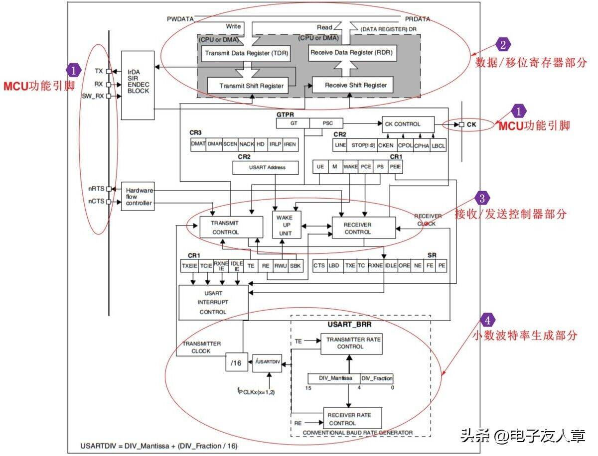

### 1.1 TTL、RS‑232、RS‑485 电平标准对比

USART是STM32内置通信外设，异步 UART 定义了数据帧的传输时序，但**并未定义电气电平**。相同的串口时序，可适配多种电平标准。

STM32 引脚输出 TTL 电平，而 RS‑232、RS‑485 是另外两种常用串口电气规范，在电压、传输距离、抗干扰上各有取舍，下面对比这三类电平标准。

串口通信的核心是电平信号，不同标准的传输距离、抗干扰能力差异大，不能直接互相连接，否则会出现乱码。下面我用一个表来说明之间的联系。

| 电平标准 | 逻辑 1       | 逻辑 0       | 最大通信距离 | 通信特点                                         |
| -------- | ------------ | ------------ | ------------ | ------------------------------------------------ |
| TTL      | 3.3V/5V      | 0V           | <5m          | 单端信号。STM32串口输出为TTL电平，适合短距离调试 |
| RS‑232   | -3V~-15V     | +3V~+15V     | 15m          | 单端信号。电平与TTL不兼容，必须电平转换芯片      |
| RS‑485   | A电位<B 电位 | A电位>B 电位 | 1200m        | 差分信号。用于长距离通信                         |

如下图所示为三者电平对比图

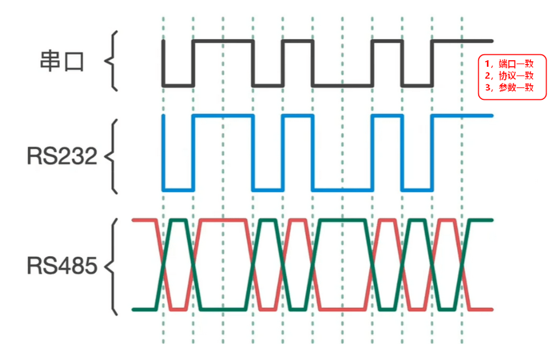

### 1.2 CH340 USB‑TTL 转换模块工作原理

:large_blue_diamond:CH340是USB转串口芯片，用来实现电脑USB信号和单片机TTL串口信号之间的协议转换。实物 如下图所示。

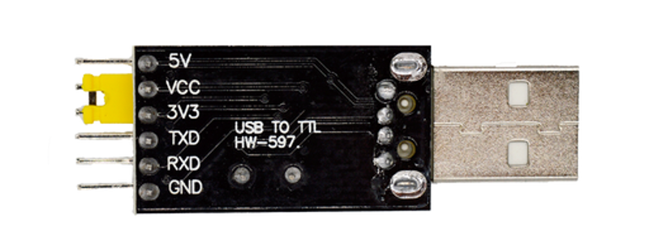

:large_blue_diamond:电脑USB总线传输的数据，经过 CH340 芯片内部协议解析，转换为 TTL 串口信号。同时反向也可以把单片机发出的TTL串口数据打包成USB数据上传电脑。

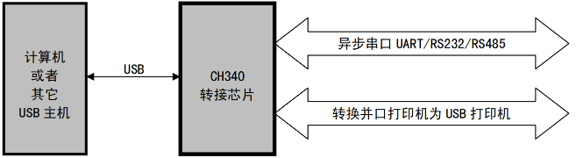

## 2 电脑串口信息传输

### 2.1 文件大小、波特率与传输时间关系分析

实验需配备两个电脑和两个CH340,CH340的TX与RX交错接，

:red_circle:注意：实验必须将两个模块 GND 引脚短接共地，下文为大家解释原因

:large_blue_diamond:两块模块分别插在两台电脑 USB 口。两台电脑打开 SSCOM 串口助手，相关参数保持一致。首先选择CH340串口，再打开串口，最后打开发送文件。接收端需选择接受数据到文件。串口传图片演示如下图所示。

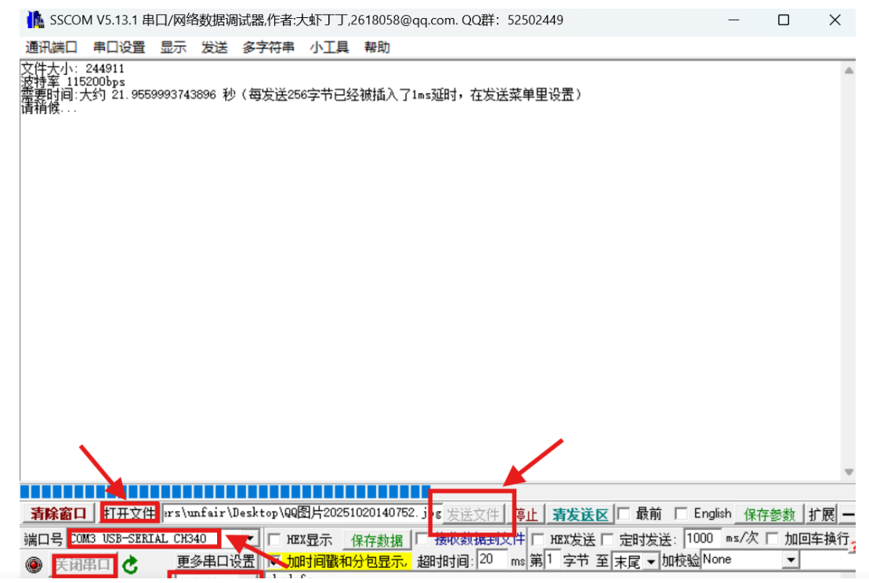

:large_blue_diamond:在发送界面可以看到文件大小、波特率和预估传输时间，实际测量传输时间大于10.47s。

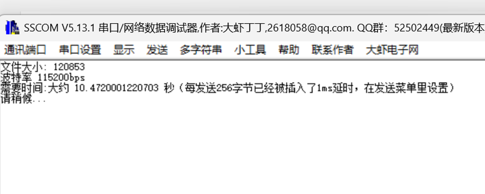

我们可以得到三者之间的关系：

文件大小 120853 字节、波特率 115200bps 为例，因为每字节传输 10bit。

理想理论时间
$$
T=\frac{120853 \times 10}{115200} \approx 10.49\mathrm{s}
$$
实际传输时间总是大于理论计算时间。

是因为串口助手会对大文件进行分包发送；操作系统任务调度存在延时，串口硬件缓冲区、软件间隙带来额外耗时。如下图，接收端成功接收图片。

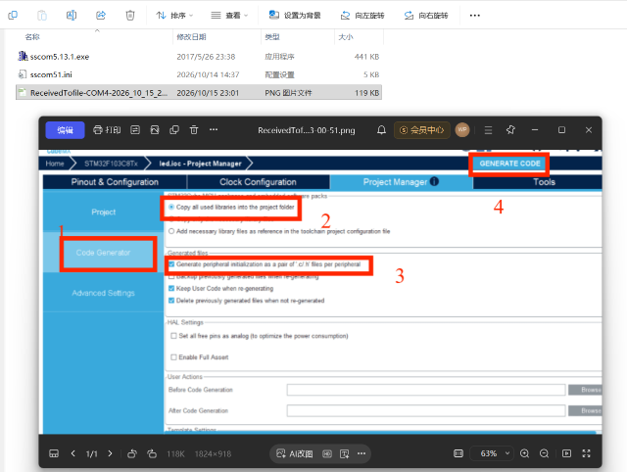

### 2.2 缺少GND地线电源线对串口通信的影响分析

如果只交叉连接 TX‑RX、RX‑TX，不接 GND 地线，接收端无法正常接收文件。

:large_blue_diamond:原因：串口是电压信号，GND是通信双方统一的0V电压参考点。只接收发信号线，两个模块x电位处于悬浮状态，如果两端对参考点的电位不一致，接收端无法正确识别高低逻辑电平。现象表现为乱码、字节丢失。

## 3 任务一：STM32 HAL库USART1轮询串口实验

任务一我采用轮询方式实现串口数据发送，观察有无延时发送数据是否丢失；轮询阻塞实现上位机字符指令控制发送暂停。

### 3.1 CubeMX 工程与串口参数配置

1.新建工程，选择芯片STM32C8T6。

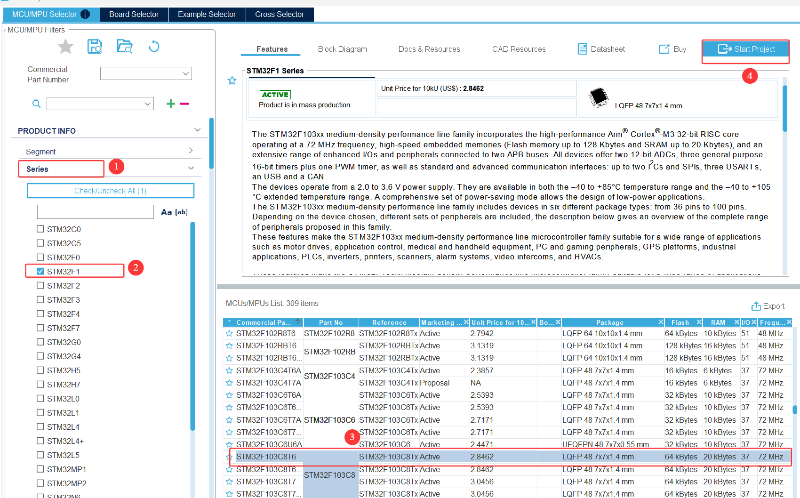

2.更改时钟为72HZ。选择 HSE 外部高速晶振,时钟树设置HSE=8MHz，PLL倍频后系统时钟SYSCLK=72MHz。

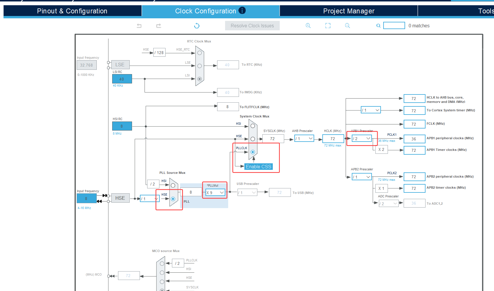

3.USART1配置：模式选择Asynchronous异步串口；引脚分配PA9TX、PA10RX。设置波特率115200，数据位8，停止位1，无校验位None。

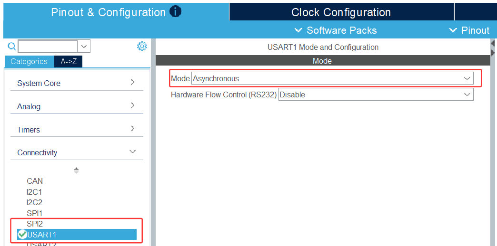

4..设置文件名称后生成Keil MDK工程文件。

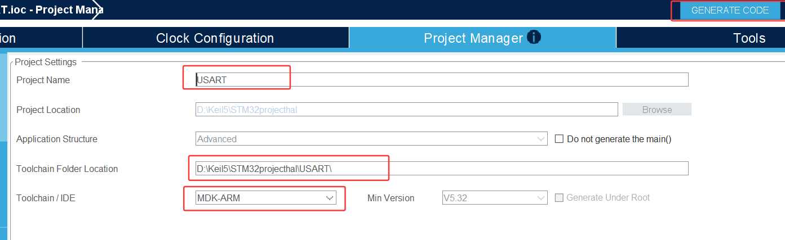

### 3.2 有无延时连续发送hello windows！

:large_blue_diamond:我们需要修改初始代码中的main.c。

在/* USER CODE BEGIN PV */下方插入如下代码作发送语句。

```c
uint8_t tx_data[] = "hello windows!\r\n";/*发送语句*/
```

修改while循环延时连续发送“hello windows！”。

```c
while (1)
  {
    /* USER CODE BEGIN 3 */
    /* USART1发送字符串 */
    HAL_UART_Transmit(&huart1, str, sizeof(str)-1, 100);
    HAL_Delay(500);/*500ms延时*/
    /* USER CODE END 3 */
  }
```

:large_blue_diamond:生成Keil文件烧录到STM32,之后用STM32连串口CH340收发串口,接线图如下图所示：

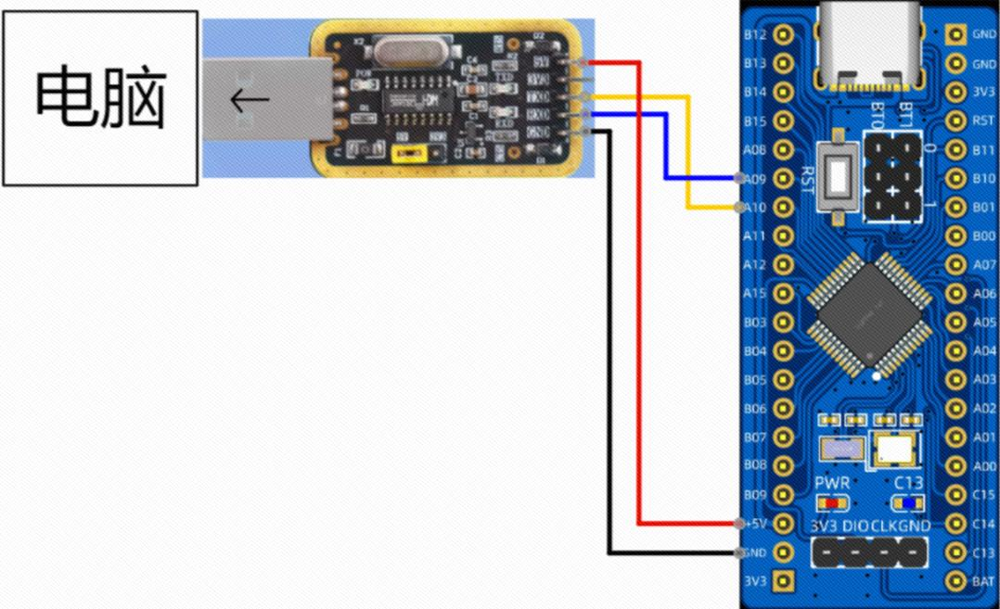

:large_blue_diamond:打开串口，搭建可以自行下载串口助手，可以看到串口稳定接收“hello windows！”

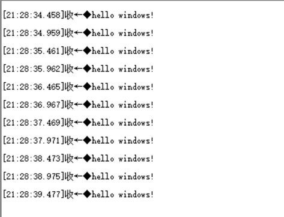

:large_blue_diamond:若去掉延时，需删掉While循环中**HAL_Delay(500)**语句。可以看到如下图串口助手收到的字符串重复刷屏，无法稳定完整输出“hello windows！”，数据丢失。

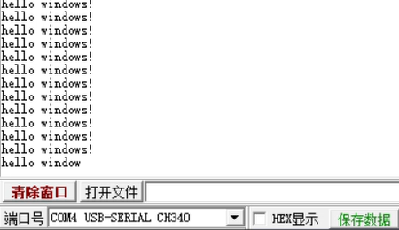

### 3.3 上位机指令控制：#暂停、*继续发送

我们需要在连续发送“hello windows!"设置”#“停止向上位机发送”hello windows！“，”*“恢复发送。

:large_blue_diamond:我们需要定义全局变量来存储串口接收字节以及控制串口发送的使能状态。修改main.c中文件。

> ```c
>/* USER CODE BEGIN PV */
> uint8_t send_str[] = "hello windows!\r\n";
> uint8_t recv_byte;        //存放接收到的1字节数据
> uint8_t send_flag = 1;    //发送使能标志：1允许发送，0暂停发送
> /* USER CODE END PV */
> ```

:large_blue_diamond:其次我们还需要在while循环里添加发送接收逻辑。如果收到字符"#"，将发送标志置 0，停止发送；收到字符”*“，将发送标志置 1，恢复发送。修改main.c中while文件。

```c
while (1)
{
  /* USER CODE BEGIN 3 */
  //非阻塞轮询接收1个字节，超时0，没有收到立即返回
  if(HAL_UART_Receive(&huart1, &recv_byte, 1, 0) == HAL_OK)
  {
      if(recv_byte == '#')
      {
          send_flag = 0;  //收到#，关闭发送
      }
      else if(recv_byte == '*')
      {
          send_flag = 1;  //收到*，开启发送
      }
  }
  if(send_flag == 1)
  {
      HAL_UART_Transmit(&huart1, send_str, sizeof(send_str)-1, 100);
      HAL_Delay(200);  //添加延时，控制发送速率，防止丢数据
  }
  /* USER CODE END 3 */
}
```

:large_blue_diamond:实验现象如下：

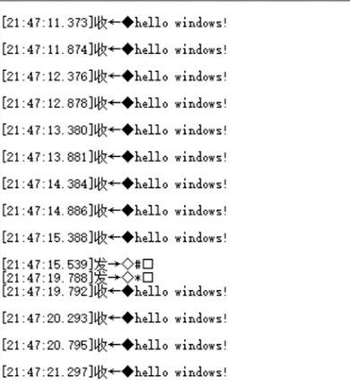

成功控制串口的发送与停止。

在轮询发送模式下，发送循环不加延时，会因为CPU速度高于串口硬件发送速度，发生数据溢出，上位机接收出现数据丢失。使用全局标志位可以实现上位机字符指令控制单片机输出启停。轮询方式直观，但实时性不足，接下来我们介绍串口中断方式发送”hello windows！“，领悟其中的不同。

## 4 任务二：串口中断与DMA通信编程实践

### 4.1 串口中断方式实现指令启停

:large_blue_diamond:其他CubeMX配置和轮询一样，需要注意的是额外添加NVIC中断设置，勾选USART1 global interrupt，开启USART1全局中断。

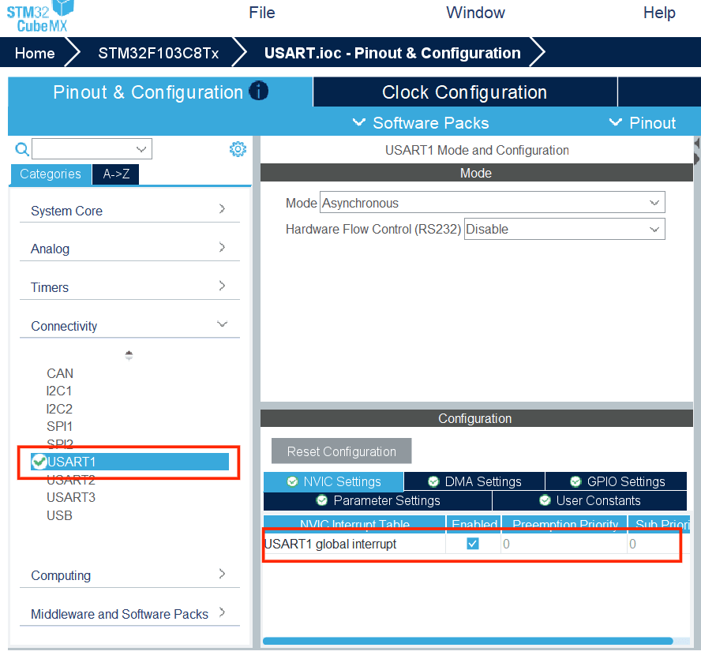

:large_blue_diamond:代码:

定义全局变量来存储串口接收字节以及控制串口发送的使能状态

```c
/* USER CODE BEGIN PV */
uint8_t tx_buf[] = "hello windows!\r\n";
uint8_t recv_byte;
uint8_t send_flag = 1;   //1允许发送，0暂停发送
/* USER CODE END PV */
```

添加**串口接收中断回调**函数

```c
/* USER CODE BEGIN 4 */
//串口接收中断回调函数，收到字节自动进入该函数
void HAL_UART_RxCpltCallback(UART_HandleTypeDef *huart)
{
  if(huart->Instance == USART1)
  {
      if(recv_byte == '#')
      {
          send_flag = 0;
      }
      else if(recv_byte == '*')
      {
          send_flag = 1;
      }
      //开启下一次中断接收，准备接收下一个字节
      HAL_UART_Receive_IT(&huart1, &recv_byte, 1);
  }
}
/* USER CODE END 4 */
```

开启第一次中断接收

```c
  /* USER CODE BEGIN 2 */
  //启动串口中断接收，等待上位机下发字符
  HAL_UART_Receive_IT(&huart1, &recv_byte, 1);
  /* USER CODE END 2 */
```

更改while循环

```c
  while (1)
  {
    /* USER CODE BEGIN 3 */
    // 判断发送使能标志位：send_flag=1允许发送，send_flag=0暂停发送
    if(send_flag == 1)
    {
        HAL_UART_Transmit(&huart1, tx_buf, sizeof(tx_buf)-1,100);
        HAL_Delay(200);
    }
    /* USER CODE END 3 */
  }
```

:large_blue_diamond:实验现象如下：

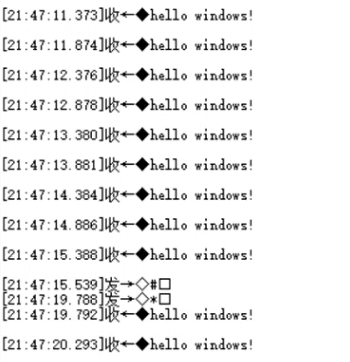

可以看到现象和任务一(2)相同，但中断方式一旦串口收到字节，立刻触发中断处理，不需要while循环不断查询，接收实时性提高。其缺点是接收大量数据时，中断频繁抢占主程序；中断回调函数内不能执行复杂代码。

### 4.2 串口DMA连续数据发送实验

DMA方式不需要CPU参与，可直接将内存的数据搬运到串口外设寄存器。CPU只需要发起一次DMA传输命令，后续数据由DMA自动搬运，CPU可以继续执行别的任务，实现高速串口发送，释放CPU 资源。

工程配置，基于串口中断配置，我们还需添加DMA请求：

:large_blue_diamond:选择USART1_TX，DMA 通道设置为Channel4，方向为Memory To Peripheral，模式为Normal普通模式，数据宽度内存 Byte，外设 Byte。如下图所示：

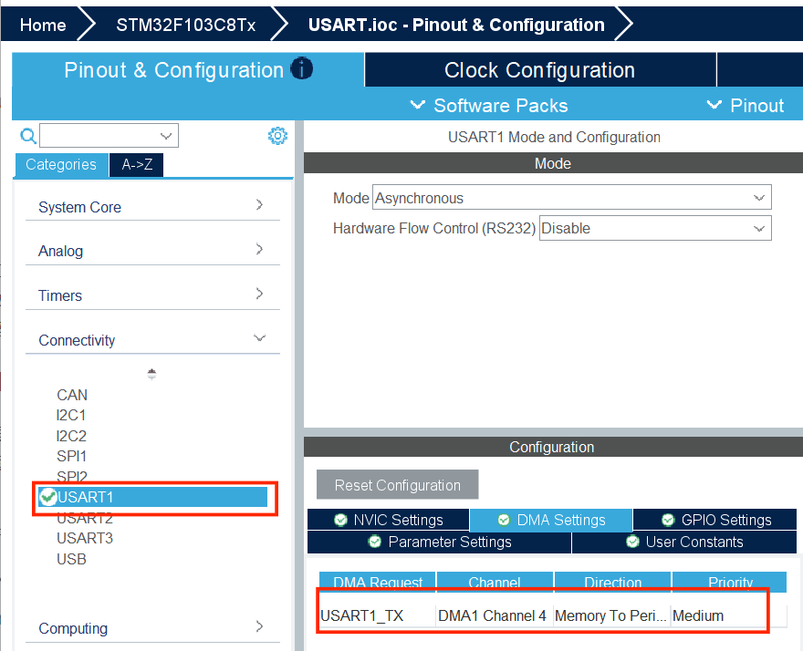

:large_blue_diamond:在USER CODE BEGIN PV添加作测试语句。

```
uint8_t tx_buf[] = "STM32 USART DMA Normal mode test\r\n";
```

:large_blue_diamond:更改循环主代码

```c
  while (1)
  {
    /* USER CODE BEGIN 3 */
    // Normal模式：只有串口空闲状态，才重新启动DMA发送，0.5s发送一次
    if(HAL_UART_GetState(&huart1) == HAL_UART_STATE_READY)
    {
		//DMA发送，启动之后CPU立刻执行，不需要等待发送完成
        HAL_UART_Transmit_DMA(&huart1, tx_buf, sizeof(tx_buf)-1);
    }
    HAL_Delay(500);
    /* USER CODE END 3 */
  }
```

每 500ms 检查一次串口：如果串口已经空闲，就启动新一轮 DMA 发送字符串；如果串口还在发送中，就跳过本次发送，等待下一轮循环再判断。

:large_blue_diamond:打开串口助手观察串口高速输出测试字符串。

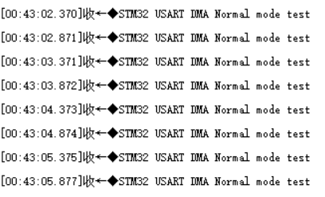

DMA 直接内存访问，实现内存与外设之间数据搬运，大批量串口发送时释放CPU资源，适合高速大数据量传输场景。

## 5 任务三：Keil 逻辑分析仪观测串口波形

### 5.1 逻辑分析仪配置操作步骤

基于USART 工程，使用Keil软件仿真，借助Keil内置逻辑分析仪分析PA9 USART1_TX引脚电平波形，观察串口异步通信帧结构，核算实际波特率。

之前的博客中已详细记录如何调出逻辑分析仪，我们添加观测引脚USART_SR查看仿真波形。


### 5.2 串口输出波特率核算与波形时序分析

可以看到仿真波形如下：

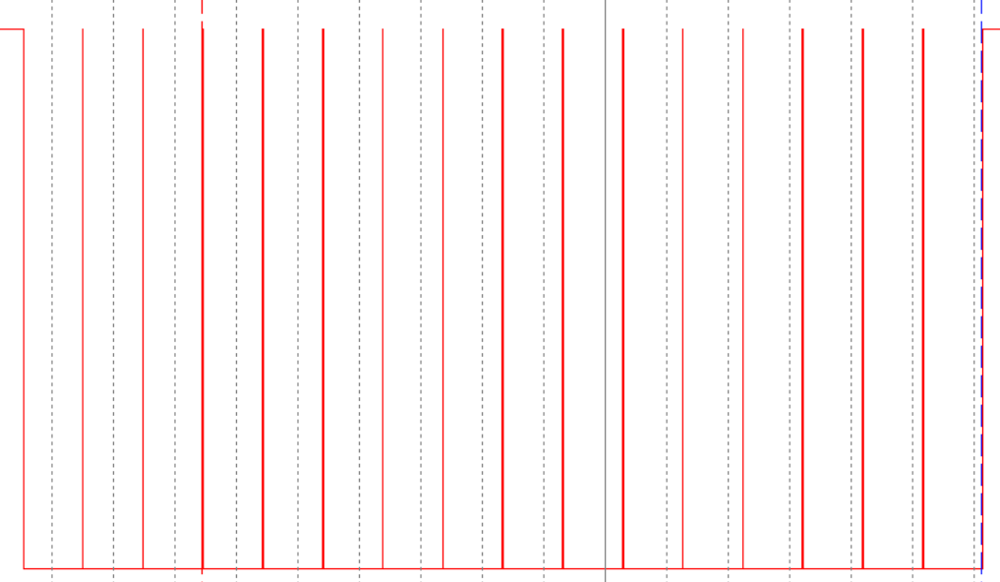

UART串口采用异步串行通信，一帧数据由1位起始位、8位数据位、无校验位、1位停止位构成。利用逻辑分析仪分析USART_SR输出方波波形，对字符帧时序进行解析并核算实际波特率。

#### 5.2.1波特率核算

波特率代表每秒传输的比特数量，本实验设定目标波特率115200，单个比特理论时间：
$$
T_{bit}=\frac{1}{Baud}=\frac{1}{115200}\approx8.6806\ \mu s
$$
在逻辑分析仪中，测量相邻bit对应的时间宽度，得到实际单比特时长。将实际单比特时间代入公式，计算实际波特率：
$$
Baud_{实际}=\frac{1}{T_{bit实际}}
$$
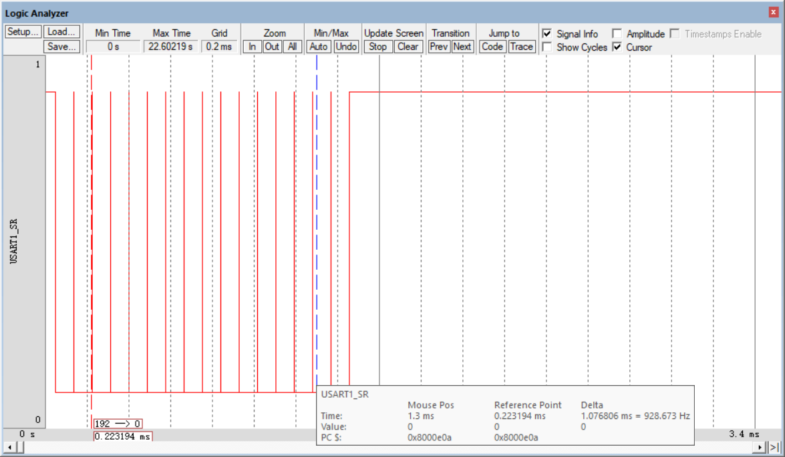

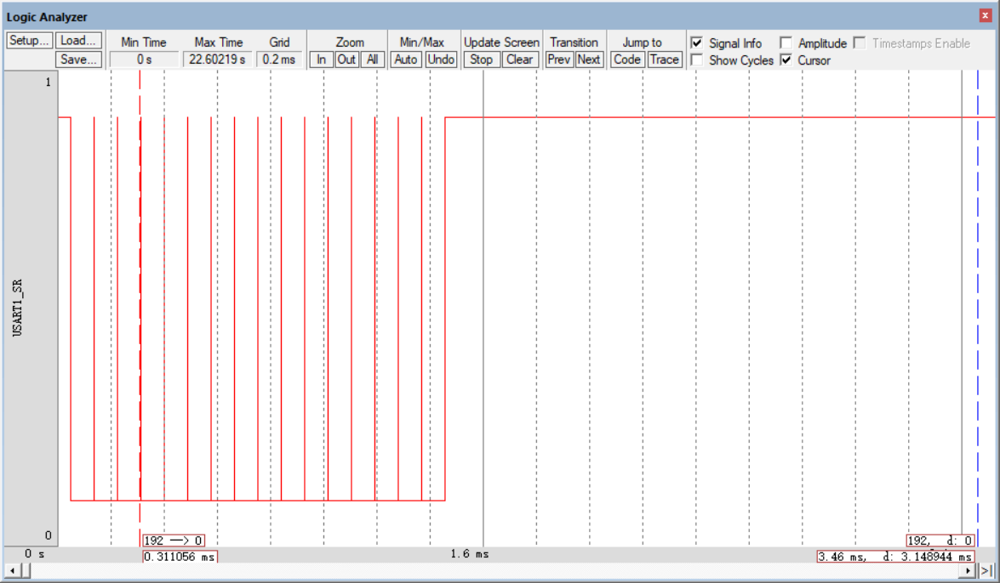

相邻帧时间宽度为85.056us,对比实际波特率117596与目标115200，
$$
\text{误差} = \frac{117596 - 115200}{115200} \times 100\%\approx +2.08\%
$$
误差在UART允许范围内，通信即可稳定。本实验时钟树配置 HSE=8MHz，系统时钟 72MHz，分频后串口波特率误差很小，上位机 SSCOM 能够正常识别接收字符串。

#### 5.2.2 波形时序分析

空闲状态下，TX引脚保持高电平；当开始发送一个字节时，引脚拉低产生下降沿，作为**起始位**，通知接收端准备接收数据。起始位之后，依次送出 bit0～bit7 共 8 位数据，最后拉高电平作为**停止位**，标志单帧传输结束。

以字符h为例，它的ASCII码为104，二进制转化为01101000。从波形起始位后，从左向右读取8个bit电平，得到发送比特序列00010110；由于UART低位先行，将比特序列反转，得到高位在前二进制01101000，对应字符h。

## 6 轮询、中断、DMA 三种串口模式对比

**轮询方式**依靠CPU持续查询串口状态标志实现通信，属于阻塞式调用。该方式代码简洁配置简单，但传输过程会占用CPU资源，实时性较差，容易丢失接收数据。

**中断方式**利用串口硬件事件触发中断，在收发事件到来时短暂抢占CPU。它具有实时性，但高频通信会触发中断，回调函数中不能执行耗时操作，多用于指令交互控制。

**DMA方式**由DMA硬件直接完成外设与内存的数据搬运，不占用CPU资源。适合大批量高速数据传输。缺点是配置流程复杂，适用于传感器采集等高速大数据场景。

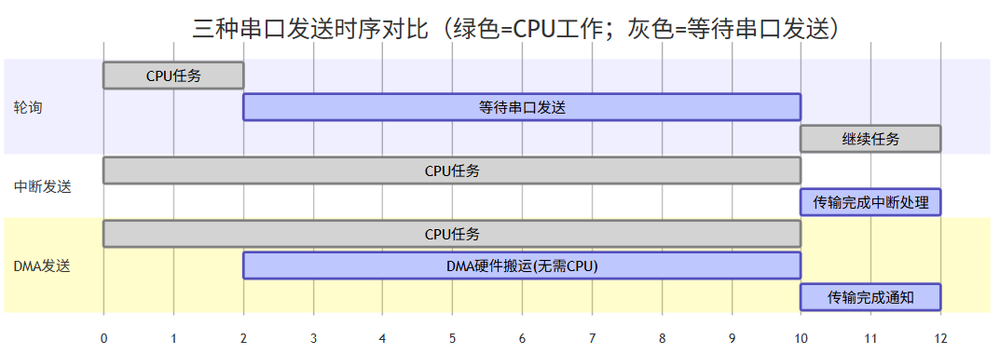

## 7 总结

本次STM32 USART串口通信实验，我领悟了了轮询、中断、DMA 三种串口数据传输方式，通过Keil逻辑分析仪获取UART波形，理解了串口低位先行的传输规则，同时借助串口调试助手完成电脑文件收发与数据校验成功在接收端识别到图片。

实验过程中也遇到过程序收发失败、波形理解困难等问题，检查发现接线需要完整无误，时钟程序收发失败配置72HZ、逐位解析方波，弄懂了UART底层通信原理。轮询、中断、DMA 三者在CPU占用、实时性、开发复杂度上各有取舍。轮询简单易上手，但会阻塞程序；中断可以及时响应外部指令；DMA适合大批量高速数据传输，能够解放CPU。

本次实验我意识到UART通信本质是比特流的有序传输，轮询、中断、DMA 只是数据搬运的不同实现手段，协议本身没有变化。